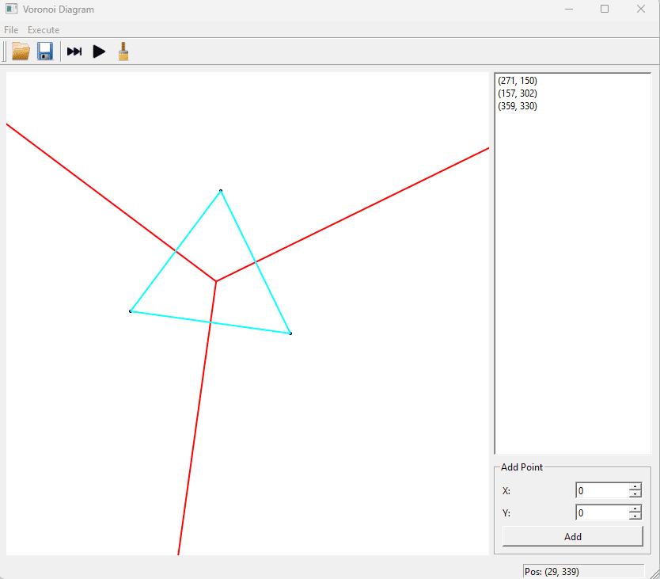

# Voronoi Diagram

演算法設計與分析 Term Project：以課本 divide-and-conquer 演算法實作的 Voronoi diagram 繪製程式（C++、Qt）。

M143040074 資工碩一 李俊諺  
[作業要求](https://nsysucbyang.github.io/my-site/course/algo/algo_report.htm)  
完整報告：[M143040074.html](M143040074.html)



## 功能

- 以滑鼠點選、手動輸入 (X, Y) 或讀入輸入檔加入點；也能讀入輸出檔直接顯示圖形。
- **Run** 直接畫出結果；**Step by step** 在每次 merge 前暫停，以不同顏色畫出左右兩個 Voronoi diagram。
- 將結果存成輸出文字檔。

## 執行

直接執行 `exe/VoronoiDiagram.exe`，不需安裝。執行檔需與同資料夾內的 DLL 及 `platforms/`、`styles/` 資料夾放在一起。

## 編譯

需要 Qt 6.10（MinGW 64-bit）。用 Qt Creator 開啟 `VoronoiDiagram.pro` 編譯，或在 cmd 中執行（Qt 路徑依實際安裝位置修改）：

```
set PATH=C:\Qt\6.10.1\mingw_64\bin;C:\Qt\Tools\mingw1310_64\bin;%PATH%
mkdir build-release
cd build-release
qmake ..\VoronoiDiagram.pro CONFIG+=release
mingw32-make
windeployqt --release --no-translations release\VoronoiDiagram.exe
```

## 檔案格式

- **輸入檔**：每筆測資第一行為點數 n，接著 n 行 `x y`；點數 0 表示結束，`#` 之後為註解。
- **輸出檔**：`P x y`（點）與 `E x1 y1 x2 y2`（線段），整數座標，依 lexical order 排序；射線裁到畫布邊界（610 × 610）。

## 專案結構

| 路徑 | 內容 |
|---|---|
| `src/`、`include/` | 原始碼，演算法在 `VoronoiDiagram.cpp` |
| `VoronoiDiagram.pro` | qmake 專案檔 |
| `exe/` | 可直接執行的程式與所需 DLL |
| `testcase/` | 測試輸入檔；`testcase/output/` 為各筆測資的輸出檔 |
| `img/` | 報告用圖片 |
| `M143040074.html` | 報告 |
| `M143040074.txt` | 程式原始碼合併檔 |
| `tools/merge_sources.py` | 產生程式原始碼合併檔的腳本 |

## 產生程式原始碼合併檔

修改原始碼後，在專案資料夾執行：

```
python tools/merge_sources.py
```
