# VoronoiDiagram

## Table of Contents
- [簡介](#簡介)
- [軟體規格書](#軟體規格書)
- [軟體說明](#軟體說明)
- [程式設計](#程式設計)
- [軟體測試與實驗結果](#軟體測試與實驗結果)
- [結論與心得](#結論與心得)
- [附錄](#附錄)

## 簡介
- 作者：M143040074 資工碩一 李俊諺
- 以 Windows 11, C++, Qt 6.10.0 框架實作 (Qt Creator 18.0.0 IDE)
- 1~3 點作為 Base case，採用暴力法求解；4 點以上則採用 Divide and Conquer 演算法。
- 能夠繪製 Voronoi diagram，並支援 Convex hull 的繪製。
- 可以點擊 Run 直接顯示最終結果，也能以 Step by step，觀察每一步變化。

## 軟體規格書
### 輸入與輸出（資料）規格 <a id="data-spec"></a>
- 支援以下四種輸入方式:
    - **滑鼠互動**：直接於畫布上點擊新增。
    - **手動輸入**：於右下角欄位輸入 (X, Y) 座標後點擊 Add 新增。
    - **輸入格式檔 (.txt)**：左上角 ```menu: File -> Read input text```，或是左上角 ```toolbar: Open``` (自動判斷輸入或輸出格式)。
    - **輸出格式檔 (.txt)**：左上角 ```menu: File -> Read output text```，或是左上角 ```toolbar: Open``` (自動判斷輸入或輸出格式)。
- 輸入格式檔：分為「含註解」與「不含註解」兩種格式，支援多筆測資，每筆測資第一行為點的數量 n，接下來 n 行為點的座標，檔案最後一行為 0 表示結束。
    ```
    #雙點測試
    2
    200 200
    200 200
    0
    ```
- 輸出格式檔：前半段為點座標，後半段為線段座標，均以 **lexical order** 排序，即先排序 x 座標，若相同則排序 y 座標。
    ```
    P 103 200 
    P 193 64
    P 193 370
    P 283 200
    E 0 34 193 161
    E 0 363 193 261
    E 193 161 193 261
    E 193 161 437 0 
    E 193 261 600 476
    ```
- 輸出儲存格式如上面所述，方式有：
    - 左上角 ```menu: File -> Save```
    - 左上角 ```toolbar: Save```

### 功能規格與介面規格


- 畫布大小：610 x 610
- 左上角 menu:
    - ```File: Read input text, Read output text, Save```
    - ```Execute: Step, Run, Clear```
- 左上角 toolbar: ```Open, Save, Step, Run, Clear```
- 右上角 point list: 顯示畫布上的所有點座標。
- 右下角 Add Point: (X, Y) 點座標，Add 新增點。
- 右下角 Pos: 即時顯示滑鼠在畫布上的位置。
- 藍色線條：Convex hull；紅色線條：Voronoi edges。

### 軟體測試規劃書
- 期中目標：三個點 (含) 以下:
    - 一個點：不須做任何動作。
    - 兩個點：找兩點中垂線。
    - 三個點：先找三點 (三角形) 外心，從外心出發往三邊法向量方向畫射線。
- 期末目標：四個點以上，divide 成左右兩半，遞迴分割 (Recursively divide) 直到點數縮減為可使用暴力解的 1~3 點，再將左右兩半的解 merge，最終 merge 成原本的解。

## 軟體說明
### 安裝說明
- 軟體執行檔在 exe 資料夾中：```VoronoiDiagram.exe```，同個資料夾下的 ```Qt6Core.dll```, ```Qt6Gui.dll```, ```Qt6Widgets.dll``` 與 ```platforms``` 資料夾為軟體執行之必要條件。

### 使用說明
- 以任一種 [輸入方式](#data-spec)，例如直接任意在畫布上點擊四個點，點擊紅框的 Step，觀察每一步變化，共有 **7 個 step**。

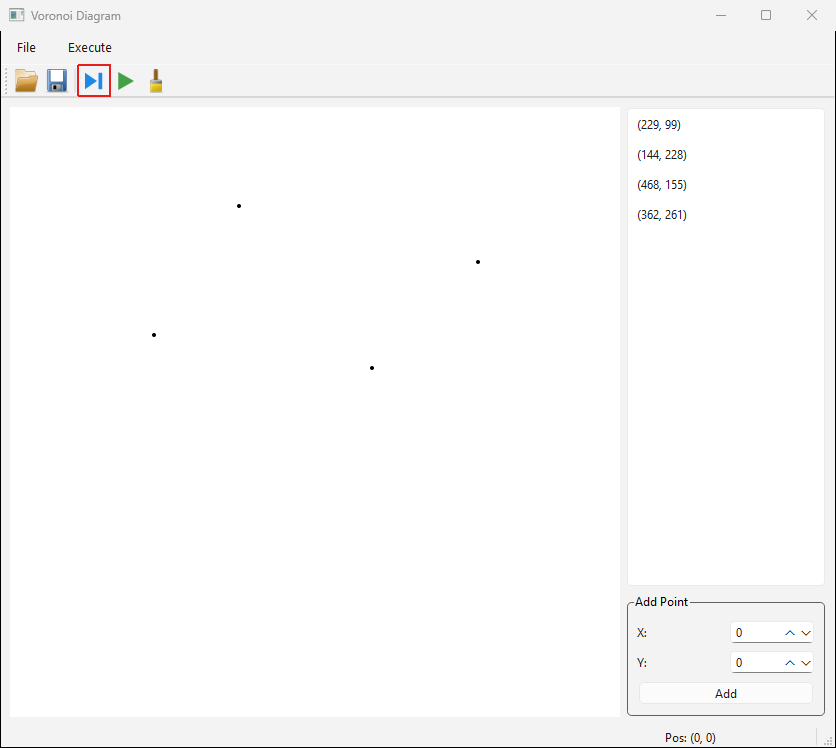

- Step 1: 畫左半 Voronoi edges

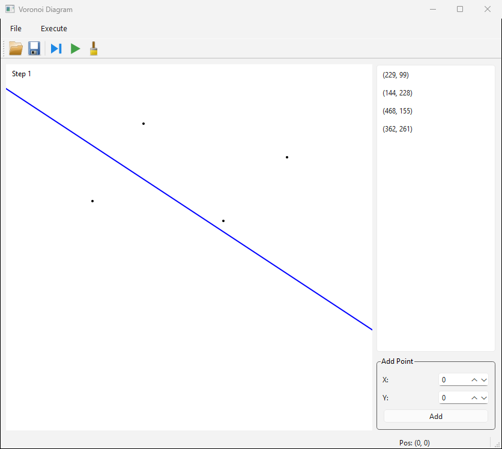

- Step 2: 畫右半 Voronoi edges

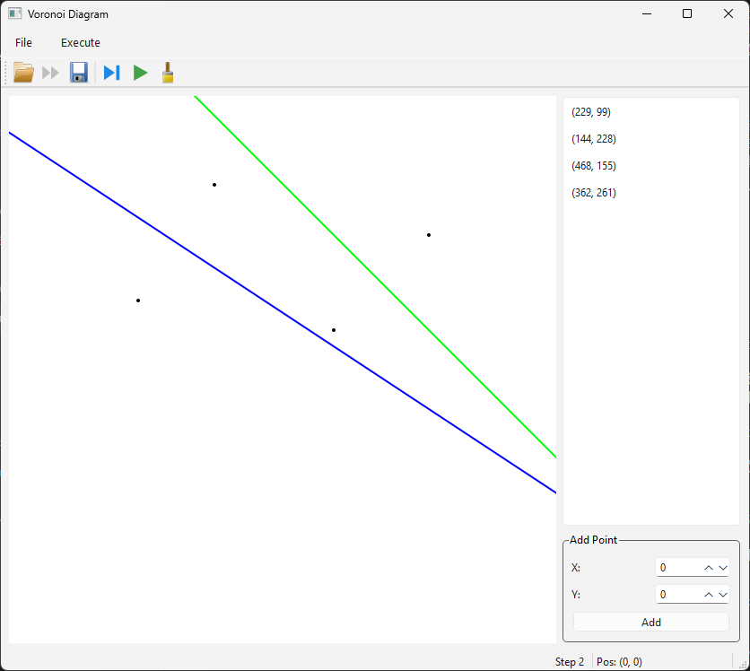

- Step 3: 畫左半 convex hull

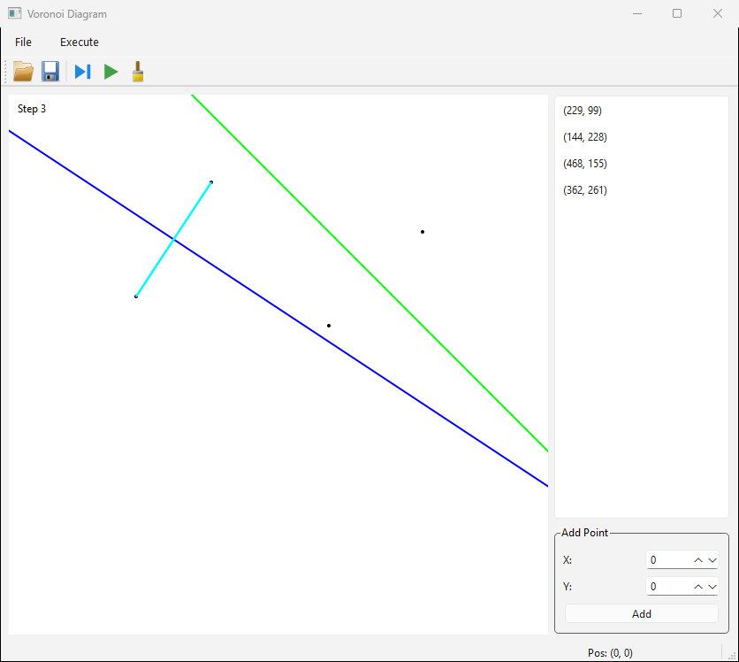

- Step 4: 畫右半 convex hull

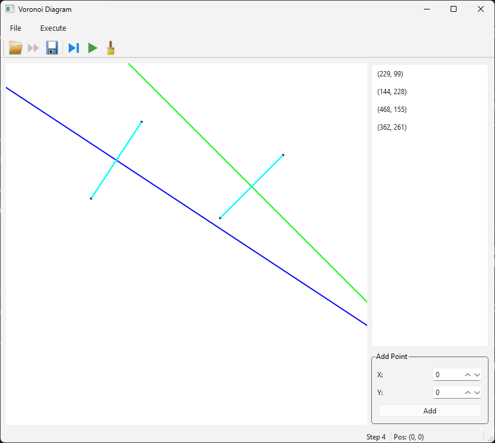

- Step 5: 畫 merge 左右兩半後的 convex hull

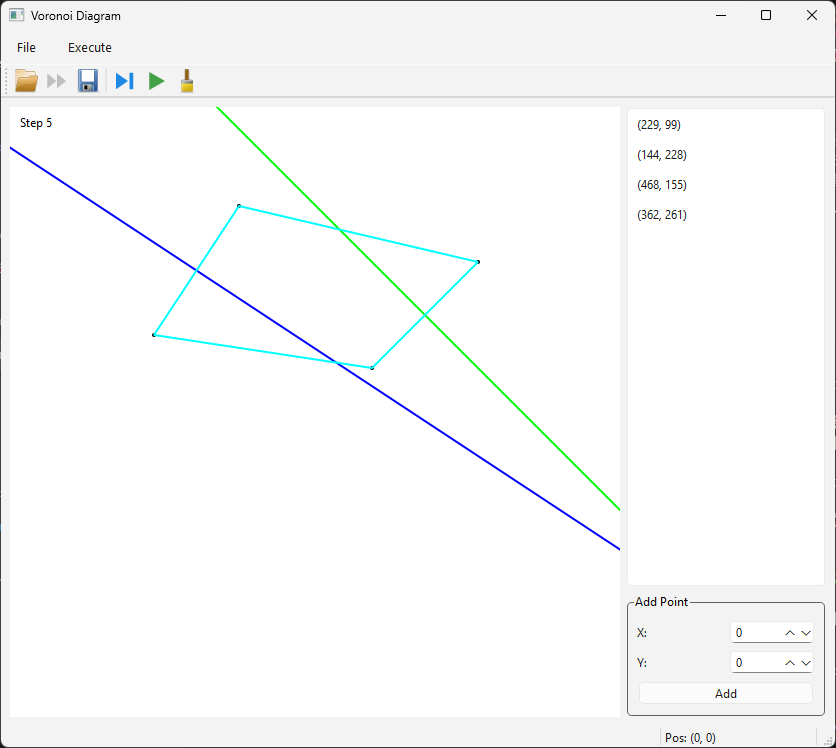

- Step 6: 畫 hyperplane

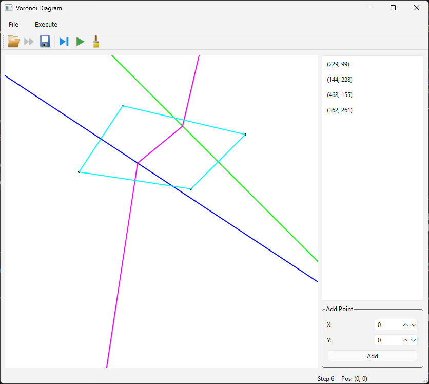

- Step 7: 最終結果

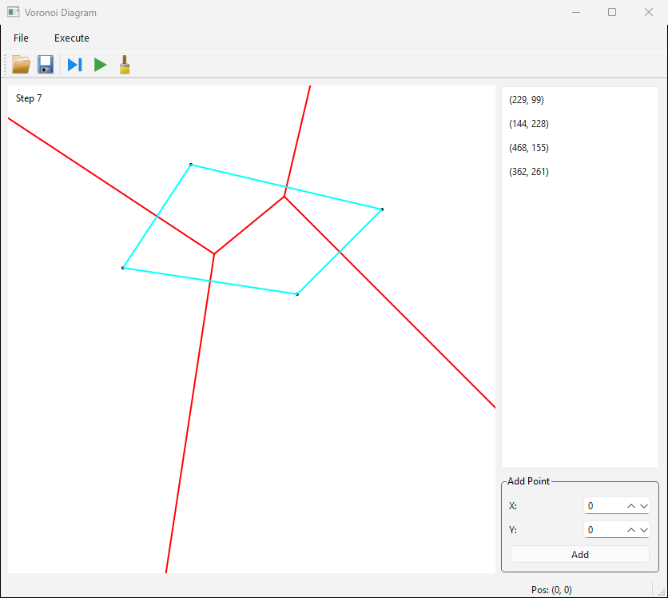

## 程式設計
### 資料結構
- 點與線分別採用 Qt 框架中的 ```QPointF``` 與 ```QLineF``` 類別實作。
```
#include <QPointF>
#include <QLineF>
```
- 自定義資料結構:
```
// 儲存結果
struct VoronoiResult {
    QVector<QLineF> edges; // Voronoi edges
    QVector<QPair<QPointF, QPointF>> endPoints; // Record which two points (p1, p2) generated edges[i]
    QVector<QPointF> convexHull; // Sort in counterclockwise order
};

// 用於 step by step
struct VoronoiStep {
    QVector<QLineF> currentEdges; // All edges at the current step (including left, right, and hyperplanes)
    QVector<QPointF> currentHull; // The merged convext hull, the left one, the right one
    QVector<int> edgeTypes; // Indicates the edge type (0: Normal, 1: Left voronoi, 2: Right voronoi, 3: Hyperplane)
    QString description; // For debugging
    int split; // 0: Merged convex hull, not 0: lefthull = currentHull.mid(0, split), righthull = currentHull.mid(split)
};

// 使 QMap 能以 QPointF 作為 Key (容許些微浮點數誤差)。
class PointKey {
public:
    QPointF p;
    PointKey(QPointF _p) : p(_p) {}
    bool operator<(const PointKey& other) const;
};
```
### 演算法
- 左上角為原點 ```(0, 0)```，往右為 ```+x``` 軸方向，往下為 ```+y``` 軸方向。
- 一開始先將點以 **lexical order** 排序，並將重複的點移除。
- 以向量 (射線) 來處理線段，若向量方向 **往右**，則法向量方向 **往上**。

#### 三點以下與共線
- **兩點**：視為共線。
- **共線**：各相鄰兩點畫中垂線。
- **三點**：先求三點 (三角形) 之外心，以外心為起點，向三個邊的法向量方向畫射線。要注意的是，例如下圖，若判斷邊的法向量方向 (紅實線)，與中點往第三點的方向 (藍實線) 同方向 (**dotProduct > 0**)，則射線方向要改為反方向 (紅虛線)。

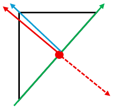

#### 四點以上
- Divide and conquer
```
VoronoiResult VoronoiDiagram::divideAndConquer(const QVector<QPointF>& points) {
    VoronoiResult res;
    int n = points.size();

    if (n == 1)
        res.convexHull.append(points[0]);
    else if (n == 2)
        res = solveCollinear(points);
    else if (n == 3)
        res = voronoi3(points);
    else {
        // Divide
        int m = n / 2;
        QVector<QPointF> leftPoints = points.mid(0, m), rightPoints = points.mid(m);
        VoronoiResult leftRes = divideAndConquer(leftPoints), rightRes = divideAndConquer(rightPoints);

        // Merge
        res = merge(leftRes, rightRes);
    }
    return res;
}
```
- **Base case**: 三點以下直接暴力解。
- 四點以上需 divide 為左右兩半，分別求出左右兩半的 Voronoi diagram 後，再做 merge。
- **Divide**: 先將 x 座標排序，切成左右各一半的點。
- **Merge** 是最困難的部分，主要分成三個步驟:
1. 找左右 convex hull 的上、下切線，並 merge 左右 convex hull: [source](https://www.naukri.com/code360/library/solving-the-convex-hull-problem-using-divide-and-conquer-algorithm)

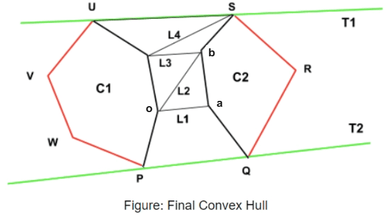

- 先找左凸包最右點，右凸包最左點，連線如上圖 L1。
- 接著找上 (下) 切線，若穿過左右凸包，則需移動端點，移動方法為：左凸包逆 (順) 時針移動，右凸包順 (逆) 時針移動。
- 判斷穿過凸包：利用 cross product 判斷方向性：根據右手定則，結果 **> 0 表示順時針旋轉，< 0 表示逆時針旋轉**。
    - 標準的 cross product 為三維的運算，結果為一向量，但可將二維的 z 分量視為 0 來運算，結果只有 z 分量不為 0，可視為一 **純量**。
    - 例如 oa 向量 = (x1, y1), ob 向量 = (x2, y2)，cross product = x1y2 - y1x2。
    - 注意此座標系與笛卡兒座標系不同，其 +x 軸方向往右，+y 軸方向往下。
    - > 0 (< 0): 拇指的方向垂直進入 (出來) xy 平面，其餘四指順 (逆) 時針旋轉
- 例如找上切線 T1：
    - L1 穿過 **右** 凸包 (**cross product < 0**)，右凸包 **順** 時針移動，得到 L2。
    - L2 穿過 **左** 凸包 (**cross product > 0**)，左凸包 **逆** 時針移動，得到 L3。
    - L3 穿過 **右** 凸包 (**cross product < 0**)，右凸包 **順** 時針移動，得到 L4。
    - L4 穿過 **左** 凸包 (**cross product > 0**)，左凸包 **逆** 時針移動，得到 T1。
- 得到上下切線後，以 **逆時針** 開始收集所有端點，從左凸包上切點 (U) 到左凸包下切點 (P)，從右凸包下切點 (Q) 到右凸包上切點 (S)，最後得到 ```U, V, W, P, Q, R, S``` 為 merge 後的所有端點。

2. 找 hyperplane
- hyperplane 是由多段 L 與 R 的垂直平分線所組成的折線。
```
從 upper tangent 開始
↓
計算目前左右點 (L, R) 的垂直平分線
↓
找此平分線最先與哪一條 Voronoi edge 相交
↓
與左側邊相交 → 更新 L
與右側邊相交 → 更新 R
↓
重複此步驟直到抵達 lower tangent
```

3. 消線 (修剪、移除多餘邊)
- 與找 hyperplane 一起進行，若撞到左邊：取出被撞到的左 Voronoi 邊 e，比較 e.p1 與 e.p2 到 L 的距離，保留較近的一端，將另一端更新為交點 (hitPoint)，以裁切超出範圍的線段。
- 此外需移除 **dangling edges**，即完全未與 hyperplane 相交的邊，這些邊是多餘的。

### Step by step
- 分為 7 個步驟逐步呈現:

|  Step   | 動作 |
|  :----:  | :----  |
| 1 | 畫左 Voronoi |
| 2 | 畫右 Voronoi |
| 3 | 畫左 convex hull |
| 4 | 畫右 convex hull |
| 5 | 畫 merged convex hull |
| 6 | 畫 hyperplane |
| 7 | 消線，最終結果 |

## 軟體測試與實驗結果
### 測試環境
- Processor: Intel(R) Core(TM) i5-14500 (2.60 GHz)
- Installed RAM: 8.00 GB (7.64 GB usable)
- System type: 64-bit operating system, x64-based processor
- Edition: Windows 11 Education
- Version: 25H2
- IDE: Qt Creator 18.0.0
- Framework: Qt 6.10.0
- Programming language: C++
- Compiler: GCC 13.1.0 (64-bit)

### 實驗結果
- 2 點

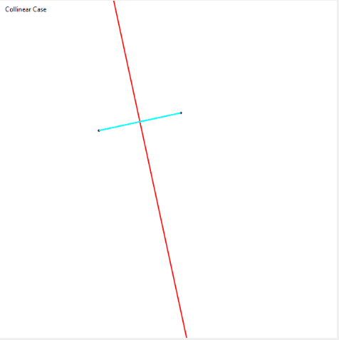

- 3 點

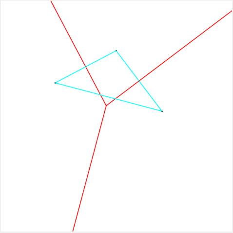
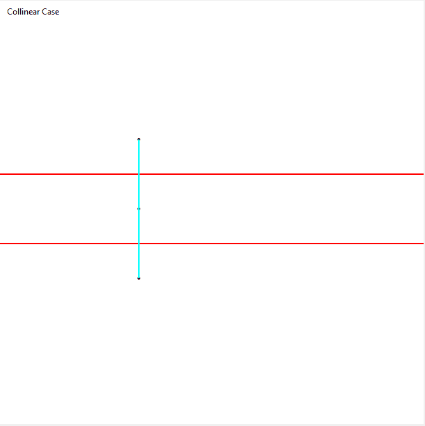
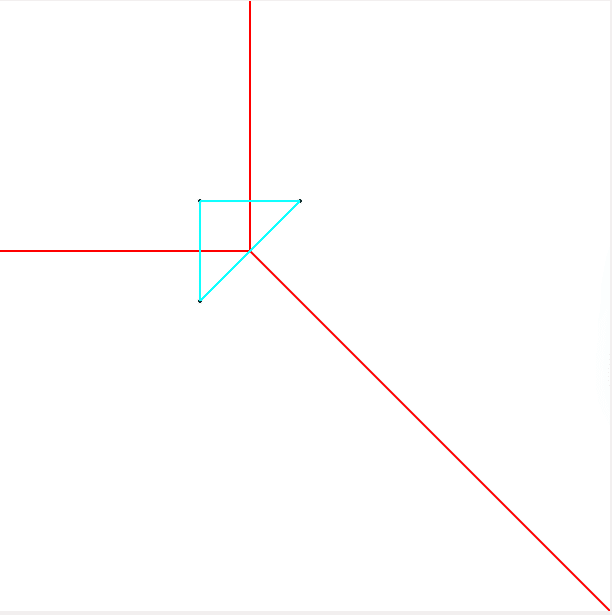
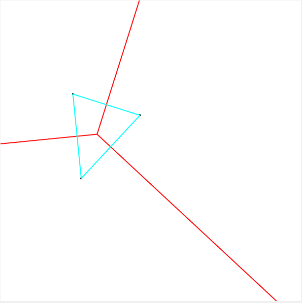

- 4 點

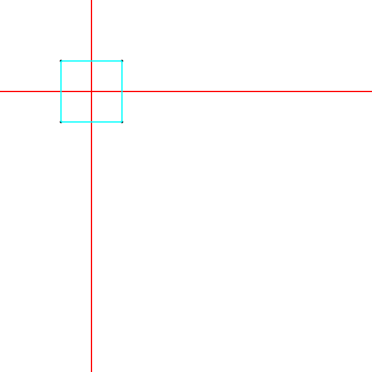
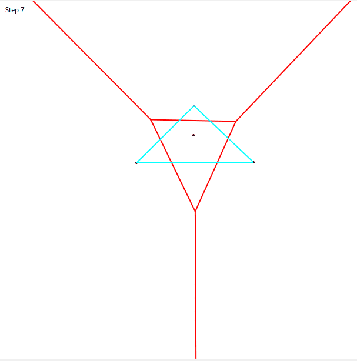
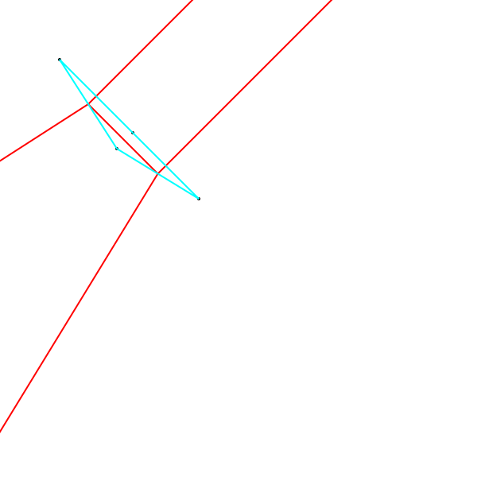

- 5 點

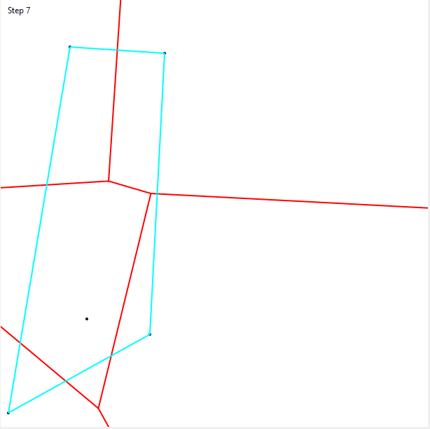

- 6 點

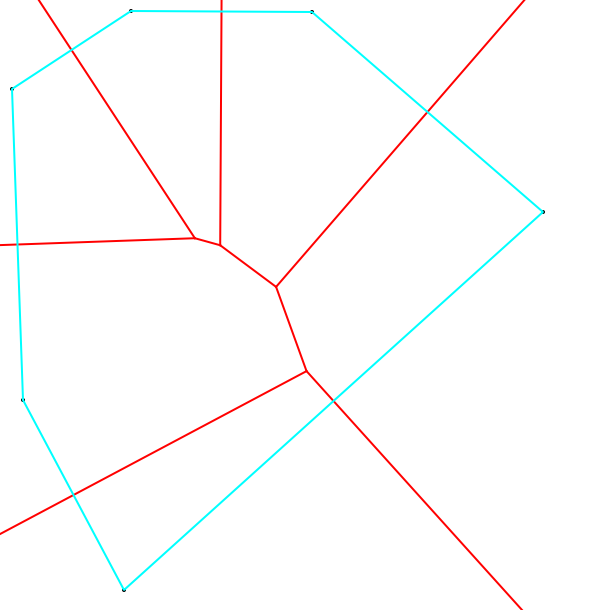

- 12 點

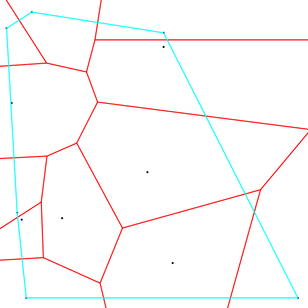

- 15 點

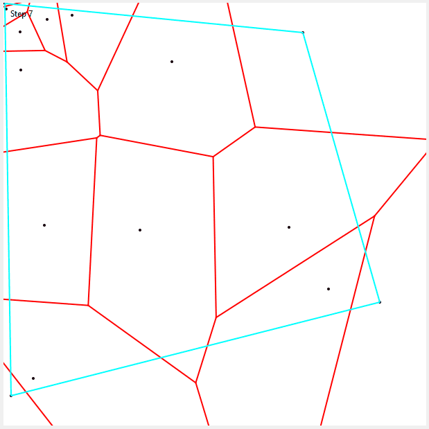

- 52 點

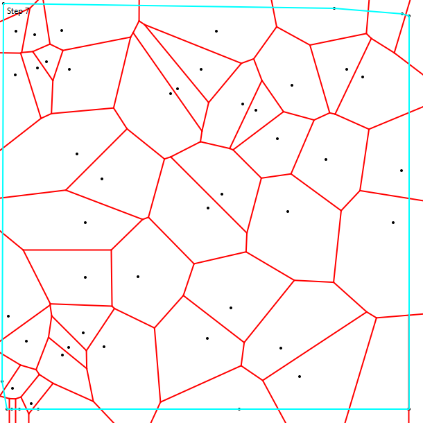

- 77 點 (失敗)

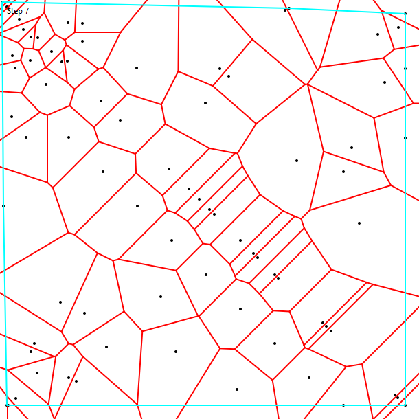

- 92 點

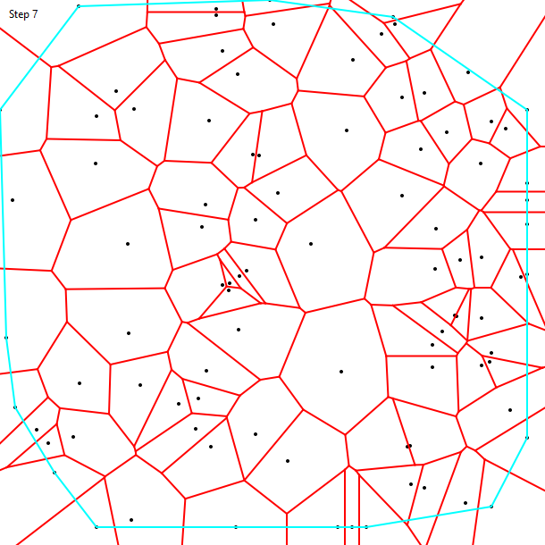

- 150 點 (失敗)

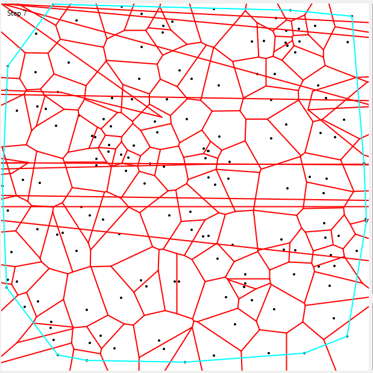

- 200 點 (失敗)

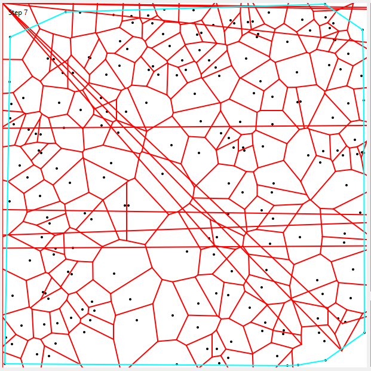

- 測資的部分在 [附錄](#附錄) 可以找到。
- 4 點以上的情況，有些會有未能正確移除的線段，推測可能是在建構 hyperplane 與執行消線的同步過程中，邏輯判斷出錯。由於此過程我認為是演算法中最困難的部分，因此還未能找出異常發生的確切原因及解決方案。

## 結論與心得
- 在選擇 GUI 框架時，曾評估功能強大但體積較大的 Qt，以及輕量級的像 FLTK。經過嘗試後發現 FLTK 在圖形功能的實現很複雜，且實作後的繪圖效果不如 Qt，最終選擇了能讓我專注於 Voronoi diagram 演算法實作的 Qt 框架。
- Qt 的開發體驗相當便利，內建的圖形資料結構（如 ```QPointF, QLineF```）可直接應用。此外，僅需一行程式碼 ```painter.setRenderHint(QPainter::Antialiasing);``` 即可實現反鋸齒效果，```Slots and Signals``` 的機制也讓互動設計更直覺。
- 在 Voronoi diagram 實作方面，雖然理論上能理解講義中的演算法，但將其轉化為程式碼時，發現許多細節處理比想像中複雜，因此在實作過程中耗費了許多時間進行除錯與邏輯驗證。
- 目前在 4 點以上的情況，偶爾會出現線段未能正確移除的問題。推測錯誤可能發生在 Hyperplane 建構與消線的邏輯判斷上。由於這部分是此演算法中最困難的步驟，目前尚未完全排除該錯誤，期望未來能修正此部分。

## 附錄
- [source code in github](https://github.com/jyli0828/VoronoiDiagram)
- [程式原始碼合併檔](M143040074.txt)
- 測資
    - [2 ~ 3 個點](testcase/2~3point.txt)
    - [4 ~ 15 個點](testcase/4~15point.txt)
    - [輸出格式](testcase/output.txt)
    - [52, 77, 92, 150, 200 個點](testcase/52,77,92,150,200.txt)
    - [特例：共線](testcase/collinear.txt)
    - [隨機生成 n 個點座標](testcase/pointGenerator.py)